<p align="center">
  
</p>

<p align="center">
  
</p>

<p align="center">
  <a href="https://linkedin.com/in/davutmertahmetoglu"></a>
  
  
</p>

### `> cat mert.py`

```python
class Mert:
    studying   = "BSc Computer Science & Engineering @ TU/e (2nd year)"
    aiming_for = "quantitative trading"
    into       = ["probability", "market making", "stochastics", "systematic strategies"]
    speaks     = {"tr": "native", "en": "C1", "fr": "C1", "de": "B1"}
    offline    = ["hiking", "camping", "goalkeeping"]
```

### `> ls ./highlights`

<p align="center">
  <a href="https://github.com/mertahmetoglu/qterm"></a>
  
</p>

### `> git log --graph`

<picture>
  <source media="(prefers-color-scheme: dark)" srcset="https://raw.githubusercontent.com/mertahmetoglu/mertahmetoglu/output/github-snake-dark.svg" />
  <source media="(prefers-color-scheme: light)" srcset="https://raw.githubusercontent.com/mertahmetoglu/mertahmetoglu/output/github-snake.svg" />
  
</picture>
