  

  

### `> ls ./highlights`

  
  

second-year computer science & engineering student at tu/e, working towards a career in quantitative trading. mostly into probability, market making and stochastics.

i speak turkish, english, french and german. away from the screen: hiking, camping and goalkeeping.

### `> git log --graph`

<picture>
  <source media="(prefers-color-scheme: dark)" srcset="https://raw.githubusercontent.com/mertahmetoglu/mertahmetoglu/output/github-snake-dark.svg" />
  <source media="(prefers-color-scheme: light)" srcset="https://raw.githubusercontent.com/mertahmetoglu/mertahmetoglu/output/github-snake.svg" />
  
</picture>
